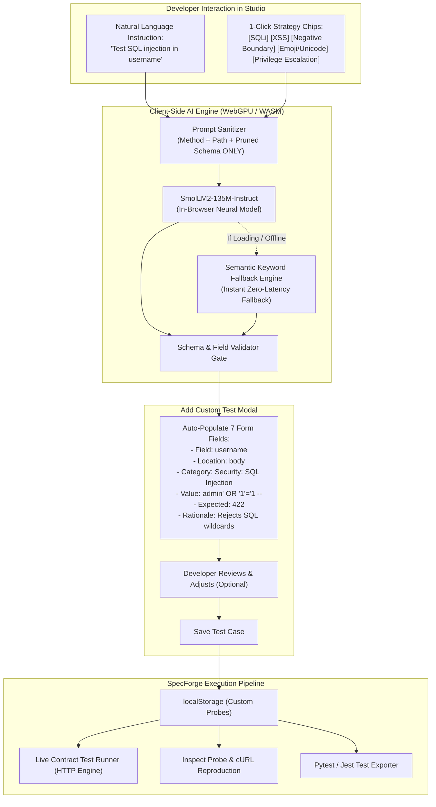

# SpecForge Dev — AI-Assisted Custom Test Synthesis Plan
**Target Project:** `specforge-dev` (Containerized Rust Engine & Studio Web UI)  
**Document Status:** Architecture & Implementation Blueprint  
**Date:** November 2026  

---

## 1. Executive Summary

In Phase 1, `specforge-dev` successfully introduced client-side WebGPU AI for **"✨ AI Randomize"**, synthesizing realistic JSON payloads while strictly maintaining a **24.4 MB static container footprint**, zero source code access, and zero direct file write access.

The next evolutionary step is **AI-Assisted Custom Test Generation**:
Empower developers to describe desired test scenarios in plain natural language (e.g., *"Test SQL injection in username"*, *"Test negative age and boundary overflow"*, *"Test checkout with inverted discount greater than subtotal"*), and automatically synthesize structured, executable contract probes that seamlessly integrate into SpecForge's fuzzing suite, live runner, and Pytest/Jest export pipelines.

---

## 2. Current Architecture vs. The AI-Enhanced Workflow

### 2.1 How Custom Tests Work Today
Currently, the Studio UI provides an **"Add Custom Field Test"** modal (`#custom-test-modal`) where developers must manually fill out 7 separate inputs:
1. `Target Field` (dropdown or custom name)
2. `Location` (`body`, `query`, `path`, `header`)
3. `Test Category / Strategy` (`Custom Boundary`, `Security: SQL Injection`, etc.)
4. `Expected HTTP Status Code` (`422`, `400`, `401`, `403`, `200`)
5. `Description / Rationale`
6. `Value Type` (`string`, `number`, `boolean`, `json`)
7. `Test Value to Inject` (e.g. `' OR '1'='1`, `-99`)

Once saved, the probe is stored in `localStorage` as:
```json
{
  "id": "cust_1731778900000_a8f9",
  "opMethod": "post",
  "opPath": "/api/v1/users",
  "field": "username",
  "location": "body",
  "category": "Security: SQL Injection",
  "desc": "Rejects username containing SQL comments",
  "valType": "string",
  "value": "admin' OR '1'='1",
  "expected": 422,
  "createdAt": 1731778900000
}
```
SpecForge's `mergeCustomProbesFromStorage()` seamlessly merges these probes into `testCases`, executing them live against backend services, showing visual pass/fail badges, inspecting raw reproduction cURLs, and exporting regression tests to Pytest and Jest.

---

### 2.2 The AI-Enhanced Workflow: Natural Language to Executable Probe



---

## 3. Core Features of the AI Custom Test Integration

### Feature A: "✨ Synthesize with AI" Section in Custom Test Modal
Located directly at the top of `#custom-test-modal`:
1. **Natural Language Input Bar:**
   - Prompt input: *"Describe the test scenario (e.g., 'Test SQL injection in username', 'Test age less than 18', 'Test role escalation to superadmin')..."*
   - Dedicated **"✨ Synthesize"** button with pulsing loading state.
2. **1-Click Attack Strategy Chips:**
   Clickable chips that immediately inject high-value test scenarios into the prompt:
   - `🛡️ SQL Injection` — generates `' OR '1'='1 --` or `admin' --`
   - `⚡ XSS / Scripting` — generates `<script>alert(1)</script>` or ``
   - `📉 Numeric Boundary` — generates `-1`, `0`, `99999999999`, or float overflow
   - `🔡 Unicode / Emojis` — generates `🚀🔥💻` or null bytes `\u0000`
   - `🕒 Temporal Reversal` — generates past expiration dates or reversed date ranges
   - `🔒 Privilege Escalation` — injects `role: "admin"` or `is_staff: true`
   - `🚫 Whitespace / Empty` — generates `\t\n  \r`
3. **Auto-Fill with Visual Highlighting:**
   - Instead of blindly saving an opaque test, the AI **fills the existing form fields** and highlights them with a subtle purple glow for 1.5 seconds.
   - The developer retains full control: they see exactly what the AI selected, can tweak the value or expected status, and click **"Save Test Case"**.

---

### Feature B: Batch AI Test Suite Generator ("✨ AI Generate Suite")
Located in the Planned Tests accordion header (next to "+ Add Custom Test"):
- Developer clicks **"✨ AI Test Suite"**.
- A small popover asks: *"How many test cases to generate?"* (Options: 3, 5, or 10).
- The AI analyzes all properties across the route and generates a balanced matrix:
  - 1 SQLi / XSS probe
  - 1 Numeric overflow / underflow probe
  - 1 Format / RegEx violation probe
  - 1 Type mismatch probe
- Immediately adds all synthesized probes to the custom test suite with 1 click.

---

## 4. Strict Security & Privacy Boundaries

To maintain SpecForge Dev's zero-trust security posture, the custom test AI engine strictly enforces:

| Threat Vector | Mitigation Strategy |
| :--- | :--- |
| **Source Code Access** | **Zero Code Access:** The prompt constructor reads **only** `op.method`, `op.path`, and the resolved schema properties. Source code files, git logs, database connections, and backend implementations are never accessed. |
| **Filesystem Write Access** | **Zero Direct File Writes:** The AI outputs a JSON object. SpecForge writes to `localStorage` and memory only. No disk files are touched. |
| **Secret Exfiltration** | **Zero Credential Exposure:** All request headers (`Authorization`, `Cookie`, API tokens) are stripped before prompt creation. |
| **Prompt Injection via API Descriptions** | All descriptions, titles, and user prompts are sanitized: delimiters like `<|im_start|>`, `<|system|>`, and `###` are stripped. |
| **Hallucinated Field Names** | **Schema Verification Gate:** The AI's proposed target field is validated against the active route's actual schema properties. If the AI hallucinates a non-existent field, the engine automatically remaps it to the nearest matching schema property or marks it as a custom property. |
| **Offline & Air-Gapped Operation** | **100% In-Browser Execution:** Powered by WebGPU / WASM with a deterministic semantic keyword fallback engine if the browser is offline or model download is cancelled. |

---

## 5. Technical Specification & Data Contract

### 5.1 AI Input Prompt Structure
```text
Endpoint: POST /api/v1/users (Create User)
Available Schema Properties:
- username (type: string, minLength: 3, maxLength: 20)
- email (type: string, format: email)
- age (type: integer, minimum: 18, maximum: 120)

Developer Instruction: "Test SQL injection in username"

Output a single JSON object with these exact keys:
{
  "field": "target property name from schema",
  "location": "body" | "query" | "path" | "header",
  "category": "short strategy name (e.g. Security: SQL Injection)",
  "expected": 422 | 400 | 401 | 403 | 200,
  "desc": "clear rationale for this test",
  "valType": "string" | "number" | "boolean" | "json",
  "value": "exact raw test value to inject"
}
```

### 5.2 Synthesized AI Output Example
```json
{
  "field": "username",
  "location": "body",
  "category": "Security: SQL Injection",
  "expected": 422,
  "desc": "Rejects username containing SQL injection delimiter and comment syntax",
  "valType": "string",
  "value": "admin' OR '1'='1 --"
}
```

### 5.3 Deterministic Keyword Fallback Matrix
If WebGPU inference is offline, loading, or fails parsing, the **Rule-Based Semantic Synthesizer** parses the instruction using regex keywords:

| Keyword Patterns in Instruction | Synthesized Category | Value Injected | Expected Status |
| :--- | :--- | :--- | :--- |
| `sql`, `sqli`, `injection`, `database` | `Security: SQL Injection` | `admin' OR '1'='1 --` | `422` |
| `xss`, `script`, `html`, `tag` | `Security: XSS / Scripting` | `<script>alert('specforge')</script>` | `422` |
| `negative`, `underflow`, `below` | `Boundary: Negative Underflow` | `-1` or `schema.minimum - 1` | `422` |
| `overflow`, `large`, `max`, `huge` | `Boundary: Numeric Overflow` | `schema.maximum + 99999` or `99999999` | `422` |
| `emoji`, `unicode`, `special`, `ascii` | `Encoding: Unicode / Emojis` | `🚀 User \u0000 💻` | `422` |
| `whitespace`, `blank`, `space`, `empty` | `Boundary: Empty / Whitespace` | `"   "` or `""` | `422` |
| `role`, `admin`, `privilege`, `escalate` | `Security: Privilege Escalation` | `{"role": "superadmin"}` | `403` |

---

## 6. Implementation Plan & Milestones

### Milestone 1: Modal UI Upgrades
- Add prompt bar + strategy chips in `#custom-test-modal` above the field selector.
- Add "✨ Synthesize" button with loading spinner and status feedback.
- Add CSS transition for glowing purple outline on auto-filled inputs.

### Milestone 2: AI Synthesizer Engine
- Implement `synthesizeCustomProbeFromInstruction(instruction)`:
  - Sanitizes user input and endpoint schema.
  - Calls `window.__specforge_ai_pipeline` (WebGPU / Transformers.js).
  - Parses and validates JSON output through the schema gate.
- Implement `synthesizeProbeWithKeywords(instruction, schema)` fallback engine.

### Milestone 3: Auto-Fill & Review Interactivity
- Populate:
  - `#custom-field-select` / `#custom-field-name-input`
  - `#custom-field-location`
  - `#custom-category-input`
  - `#custom-expected-status`
  - `#custom-desc-input`
  - Value type radio buttons + `#custom-val-input`
- Trigger brief highlight animation so the user visually sees what was populated.

### Milestone 4: Seamless Pipeline Verification
- Click **"Save Test Case"**.
- Verify probe appears in the test table with custom badge.
- Run test: verify HTTP execution against target backend or dynamic mock.
- Click "Inspect Probe": verify injected value and reproduction cURL.
- Open "Pytest Export" modal: verify the custom test is included in the exported Pytest file.

---

## 7. Recommended Next Step
Upon your review and approval of this plan, we can proceed to implement Milestone 1 through Milestone 4.
